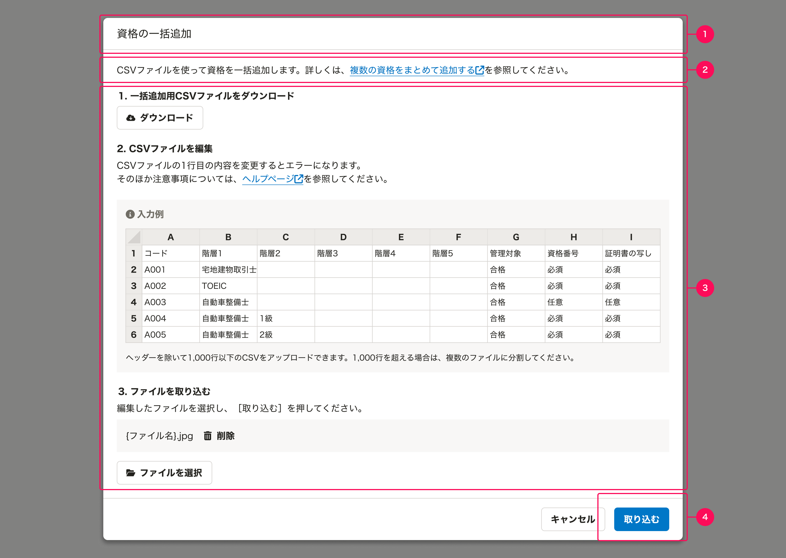

CSVファイルを取り込んで、データを一括で操作する画面のライティングについてまとめています。
ライティングは、[基本的な考え方](/products/contents/writing-style/)、[用字用語](/products/contents/idiomatic-usage/)に準拠します。
CSVファイルの取り込みによる一括操作の画面特有の気をつけるべきポイントを記載しています。

## 基本的な考え方

この画面で重要なのは、ユーザーがCSVファイルを正しく編集し、取り込めることです。

ユーザーが理解しやすいように、手順を簡潔かつ具体的に記載しましょう。

## 構成

CSVファイルの取り込みによる一括操作の画面は、以下の要素で構成されています。
1. 画面名
2. 説明文
3. 手順
4. ボタン



## 1. 画面名

[画面タイトルや項目名には名詞を使用する](/products/contents/ui-text/app-writing/#use-nouns-in-screen-titles-and-field-names)に則り、**`{{オブジェクト名}}の一括{{操作}}`** を基本形とします。

ユーザーがやりたいことは、CSVファイルを取り込むことではなく、データを一括で操作することです。CSVファイルはそのための手段です。そのため、画面名には「CSVファイル」よりも、ユーザーが実行する操作を優先して記載します。

CSVファイルの取り込み以外にも一括操作の方法があり、CSVファイルという手段を強調したい場合は、末尾に`（CSVファイルの取り込み）`をつけても構いません。

### 例
- `従業員の一括更新`
- `発令の一括追加（CSVファイルの取り込み）`

## 2. 説明文

説明文は簡潔に書きます。

`CSVファイルを使って{{オブジェクト名}}を一括{{操作}}します。詳しくは、{{ヘルプページタイトル}} <OpenInNewTabIcon visuallyHiddenText="新規ウィンドウ" /> を参照してください。`

ヘルプページへの動線は、[ヘルプページへの動線](/products/contents/ui-text/help-link/)に従います。

## 3. 手順

CSVファイルを取り込むまでの手順を簡潔に書きます。
例示した他にも必要な手順がある場合は適切な箇所に追加してください。

例：
```
# 1. ｛{操作}｝用ファイルをダウンロード
［ダウンロード］

# 2. ファイルを編集
{{入力して欲しい内容・注意点を記載}}
{{SpreadsheetTableで例を見せる}}

# 3. ファイルを取り込む
編集したファイルを選択し、［取り込む］を押してください。
［ファイルを選択］
```

### 各手順の見出し

見出しの冒頭には、手順の順番を表す数字をつけます。

「ファイルの編集」ではなく **「ファイルを編集」** のように、助詞「を」を使います。

### 操作用ファイルの呼び名

操作用のファイルは、**`{{操作}}用ファイル`** と呼びます。
例：`一括追加用ファイル`、`一括更新用ファイル`

設定した項目がファイルのヘッダーに反映されず、ダウンロードしたファイルをそのまま使えない場合（例：給与明細機能）は、**`ファイルの作成例`** と呼びます。

どちらの場合も「サンプルファイル」とは呼びません。中身をイメージしづらく、[カタカナ語を用いるときには、まず漢字語での言い換えを検討する](/products/contents/writing-style/#prefer-kanji-to-katakana-words)にも反するため、上記どちらかへの言い換えを検討してください。

ダウンロードしたファイルの名称は、[ファイル名](/products/contents/ui-text/file/)に従います。

### ファイルを編集する手順の説明文

ファイルを編集する手順の説明文では、どのようにファイルを編集してほしいかを **「〜してください。」** の形で記載します。

ファイルを編集するときの注意点には、必要に応じて以下を含めます。
- 削除・編集してはいけない列
- 入力の制限
- セルを空欄にしたときの挙動

[SpreadsheetTable](/products/components/spreadsheet-table/)を使って、入力例を示します。入力項目が少ない場合には、省略しても構いません。

## 4. ボタン

ファイルを取り込むボタンのラベルは、**`取り込む`** を基本形とします。

削除など破壊的な操作で、取り込んだあとの結果を強調したい場合には、`削除`のように結果を表す文言をボタンのラベルにしても構いません。

参考： [ボタンラベルには動詞の終止形を使用する](/products/contents/ui-text/app-writing/#use-finite-verbs-in-button-labels)
