import Grid from '@/components/article/Grid.astro'
import ImgWithDesc from '@/components/article/ImgWithDesc.astro'

RBACの独自権限パターンにおける一覧画面の設計をまとめています。カスタム操作権限や独自の設定項目の有無によって画面の構成が異なります。

アカウントの追加や編集のダイアログについては、[詳細画面](/products/design-patterns/permissions-settings/rbac-standalone/single/)を参照してください。

## 画面構成

カスタム操作権限と独自の設定項目がない構成の画面です。

一覧画面では、アカウントのコレクションを[よくあるテーブル](/products/design-patterns/smarthr-table/)で表示します。テーブルにはインスタンスの「アカウント名」「操作の権限」などを表示し、操作列を設けます。

画面の構成要素は次のとおりです。

- [1. 画面タイトル](#h3-0)
- [2. リード文](#h3-1)
- [3. テーブルタイトルとアクション](#h3-2)
- [4. テーブル](#h3-3)

<Grid size="calc((100% - 24px * 1) / 2)">
  <ImgWithDesc description="ロールがない場合">
  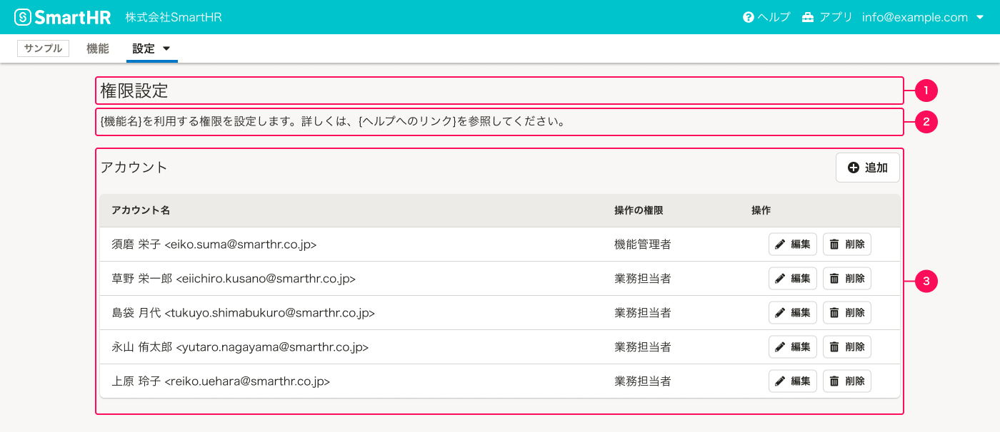
  </ImgWithDesc>
  <ImgWithDesc description="ロールがある場合">
  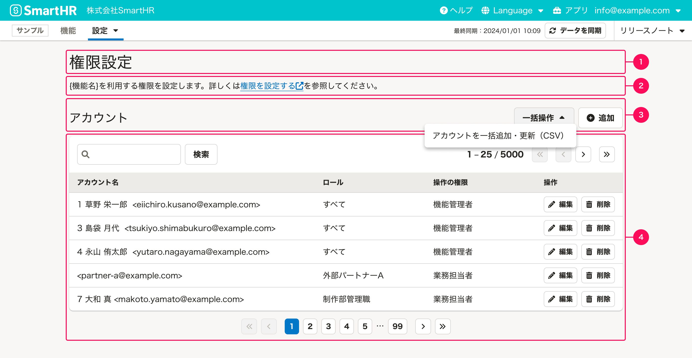
  </ImgWithDesc>
</Grid>

### 1. 画面タイトル

画面タイトルは「権限設定」とします。

### 2. リード文

[リード文](/products/design-patterns/page-layout/#h3-0)には、機能の説明や操作に関する補足テキスト、ヘルプセンターへのリンクなどを書きます。特別な補足がない場合は、以下のメッセージを使ってください。

`{機能名}を利用する権限を設定します。詳しくは、{ヘルプへのリンク}を参照してください。`

### 3. テーブルタイトルとアクション

テーブルのタイトルは`アカウント`とします。アクションにはオブジェクトの追加ボタンを配置し、ラベルは`追加`としてください。

アカウントを「[管理アカウント](/products/design-patterns/permissions-settings/rbac-standalone/#h3-0)」と呼び替えるプロダクトでは、テーブルのタイトルを`管理アカウント`とします。

CSVを用いた一括操作がある場合は追加の[DropdownMenuButton](/products/components/dropdown/dropdown-menu-button/)を配置しても構いません。

<Grid size="calc((100% - 24px * 1) / 2)">
  <ImgWithDesc description="ロールがない場合">
  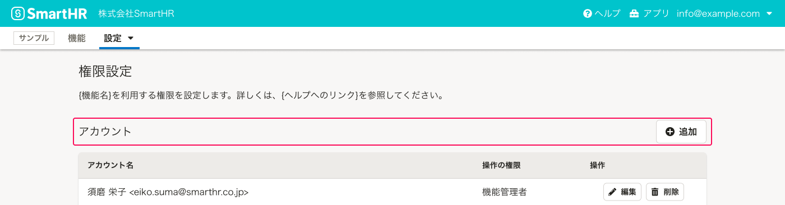
  </ImgWithDesc>
  <ImgWithDesc description="ロールがある場合">
  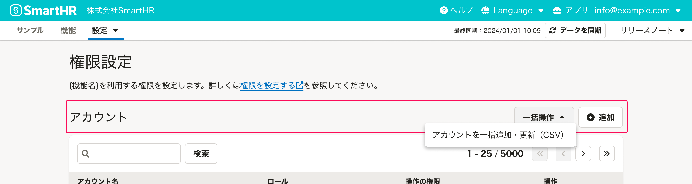
  </ImgWithDesc>
</Grid>

### 4. テーブル

基本的なレイアウトは[よくあるテーブル](/products/design-patterns/smarthr-table/)に従います。テーブルには以下の情報を必ず表示し、必要に応じて列を追加してください。

|列の項目|表示する内容|
|:---|:---|
| アカウント名 | 権限を付与するアカウントです。形式は[アカウントの表記方法ガイドライン](/products/contents/ui-text/crew-account/#account-display-format)を参照してください。 |
| ロール | ロール名を表示します。  ロールがない構成では、この列を表示しません。 |
| 操作の権限 | 操作の権限名を表示します。 |
| 操作 | アカウントの権限を操作するボタンを置きます。必要に応じて、[編集]と[削除]以外のボタンを置いても問題ありません。コンポーネントは[Secondaryボタン](/products/components/button/#h3-2)のサイズ小を使います。 |

#### 初期表示

[よくあるテーブルの初期表示](/products/design-patterns/smarthr-table/#h3-7)のパターンに従いますが、メッセージ部分は、`{機能名}の権限を持つアカウントはまだ登録されていません。`とします。

<Grid size="calc((100% - 24px * 1) / 2)">
  <ImgWithDesc description="ロールがない場合">
  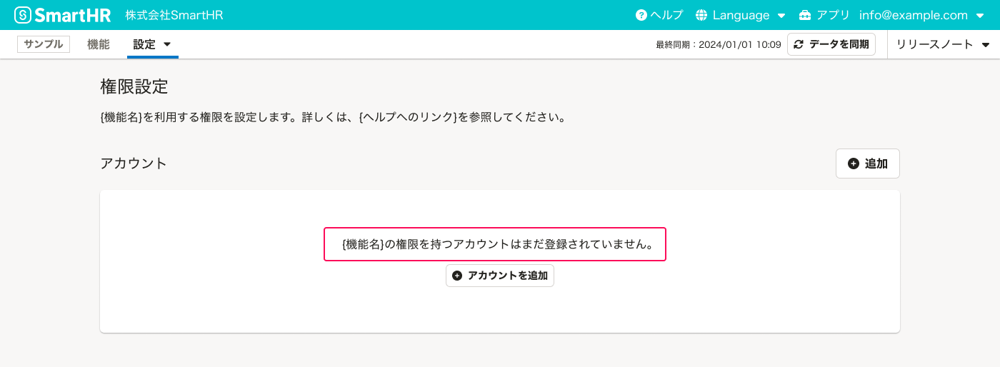
  </ImgWithDesc>
  <ImgWithDesc description="ロールがある場合">
  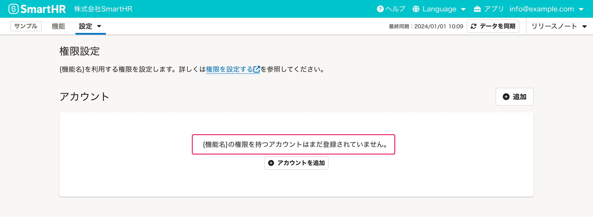
  </ImgWithDesc>
</Grid>

## カスタム操作権限と独自の設定項目

カスタム操作権限や独自の設定項目がある構成では、要素に応じて一覧画面にタブを追加し、その要素の選択肢を一覧で管理します。

タブを追加するかどうかは、その要素の選択肢をプロダクトのなかで管理するかどうかで決まります。

- **カスタム操作権限**：ユーザーが操作の権限を追加・編集できるため、「操作の権限」タブを追加します。プリセット操作権限だけの場合は、選択肢をプロダクトのなかで編集しないため、タブを追加しません。
- **独自の設定項目**：キャリア台帳の「従業員情報の表示設定」のように、アカウントの追加・編集で選ぶ選択肢の一覧を持つ場合は、「`{独自の設定項目名}`」タブを追加します。キャリア台帳の「タレントタグの表示設定」や「メモの表示設定」のように、アカウントごとに表示する・しないを決めるだけで選択肢の一覧を持たない場合は、タブを追加しません。

独自の設定項目の作成や編集が複雑な場合は、権限設定画面とは別の画面で管理しても構いません。また、アカウントと関係なく決まる設定は独自の設定項目に含まないため、タブには配置しません。詳しくは[独自の設定項目](/products/design-patterns/permissions-settings/rbac-standalone/#h3-3)を参照してください。

画面の構成要素は次のとおりです。

- 1. 画面タイトル
- 2. リード文
- [5. タブとアクション](#h3-4)
- [6. テーブル](#h3-5)

「1. 画面タイトル」と「2. リード文」は[画面構成](#h2-0)と同様です。

<Grid size="calc((100% - 24px * 1) / 2)">
  <ImgWithDesc description="ロールがない場合">
  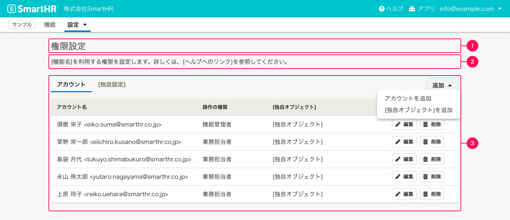
  </ImgWithDesc>
  <ImgWithDesc description="ロールがある場合">
  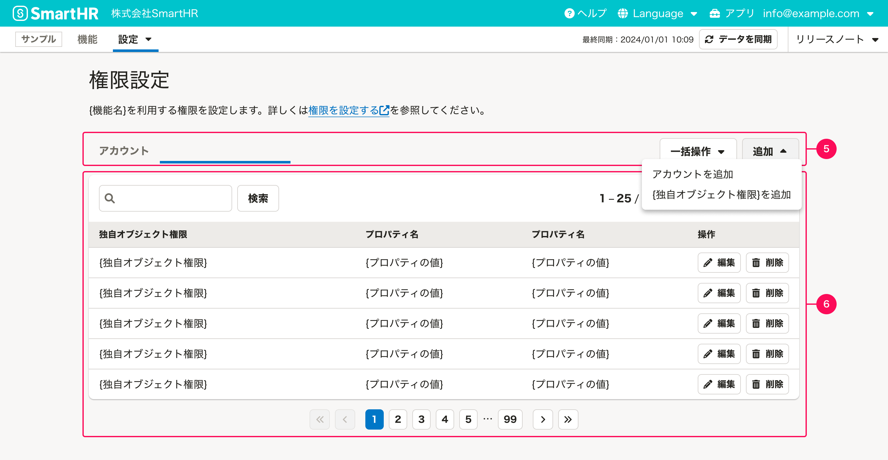
  </ImgWithDesc>
</Grid>

### 5. タブとアクション

[TabBar](/products/components/tab-bar/)を使い、「アカウント」と、「操作の権限」や「`{独自の設定項目名}`」の一覧をタブで分けます。タブのタイトルは左から`アカウント`、`操作の権限`、`{独自の設定項目名}`の順とし、構成にない要素のタブは設けません。

それぞれのオブジェクトを追加するには[DropdownMenuButton](/products/components/dropdown/dropdown-menu-button/)を使い、ラベルは`追加`とします。ドロップダウンパネル内のボタンラベルは、`アカウントを追加`、`操作の権限を追加`、`{独自の設定項目名}を追加`とします。

アカウントを「管理アカウント」と呼び替えるプロダクトでは、タブのタイトルを`管理アカウント`、ボタンラベルを`管理アカウントを追加`とします。

CSVを用いた一括操作がある場合は追加のDropdownMenuButtonを配置しても構いません。

<Grid size="calc((100% - 24px * 1) / 2)">
  <ImgWithDesc description="ロールがない場合">
  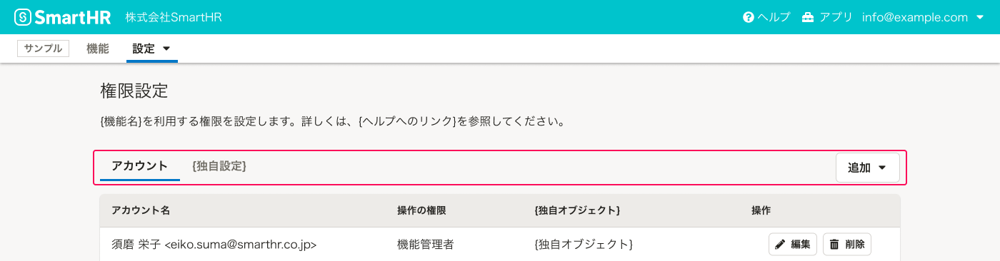
  </ImgWithDesc>
  <ImgWithDesc description="ロールがある場合">
  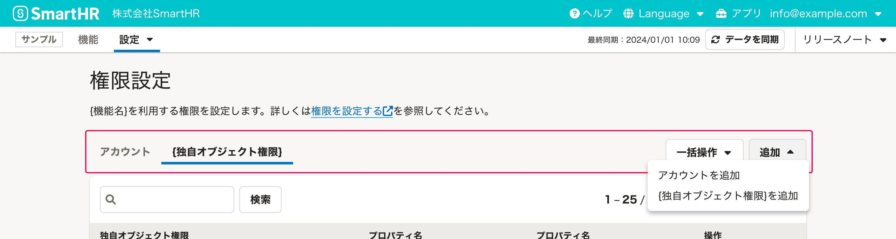
  </ImgWithDesc>
</Grid>

### 6. テーブル

「アカウント」タブは[画面構成のテーブル](#h3-3)と同様です。

「操作の権限」タブと「`{独自の設定項目名}`」タブも[よくあるテーブル](/products/design-patterns/smarthr-table/)で表示します。表示する列は、プロダクトの仕様に応じて決めてください。

#### 初期表示

- **「操作の権限」タブ**：プリセット操作権限（「機能管理者」「業務担当者」など）があらかじめ登録されているため、初期表示ではプリセット操作権限を表示します。
- **「`{独自の設定項目名}`」タブ**：[よくあるテーブルの初期表示](/products/design-patterns/smarthr-table/#h3-7)のパターンに従い、メッセージ部分は`{独自の設定項目名}はまだ登録されていません。`とします。

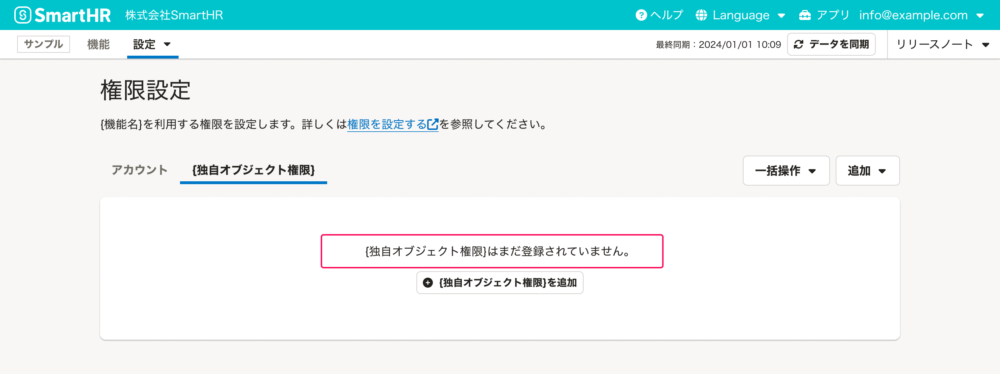

## 関連リンク

- [RBACの独自権限パターン](/products/design-patterns/permissions-settings/rbac-standalone/)
- [詳細画面](/products/design-patterns/permissions-settings/rbac-standalone/single/)
