import Grid from '@/components/article/Grid.astro'
import ImgWithDesc from '@/components/article/ImgWithDesc.astro'

RBACの独自権限パターンにおける詳細画面の設計をまとめています。権限の[要素](/products/design-patterns/permissions-settings/rbac-standalone/#h2-1)や、アカウント追加か編集かによって画面の構成が異なります。

アカウントや独自の設定項目の一覧については、RBAC独自権限の[一覧画面](/products/design-patterns/permissions-settings/rbac-standalone/collection/)を参照してください。

## ロールがない場合

「アカウント」「操作の権限」の2つの要素を持つ構成の詳細画面です。

一覧の[（アカウントを）追加]、または[（アカウントを）編集]ボタンを押したときに[ActionDialog](/products/components/dialog/action-dialog/)で表示します。
例はすべて追加時のスクリーンショットです。必要に応じて編集に読み替えてください。

構成要素は次のとおりです。

- [1. ダイアログタイトル](#h3-0)
- [2. アカウントの選択](#h3-1)
- [3. 操作の権限](#h3-2)
- [4. 独自の設定項目](#h3-3)

**詳細ダイアログ（アカウントのみ）**
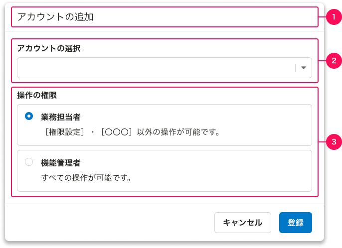

**詳細ダイアログ（独自の設定項目がある場合）**
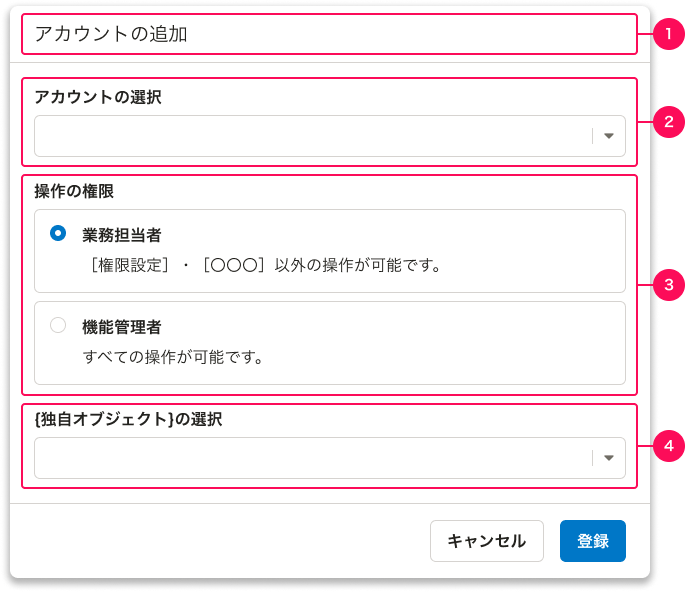

### 1. ダイアログタイトル

追加の場合は、「アカウントの追加」とします。編集の場合は、「アカウントの編集」とします。

### 2. アカウントの選択

SmartHRのアカウントを選択します。複数のアカウントを一括で追加できるよう、[MultiCombobox](/products/components/combobox/multi-combobox/)を使います。

Comboboxのパネル内の説明には`{検索対象名1}、{検索対象名2}で検索できます。`と、検索できる項目を明記します。

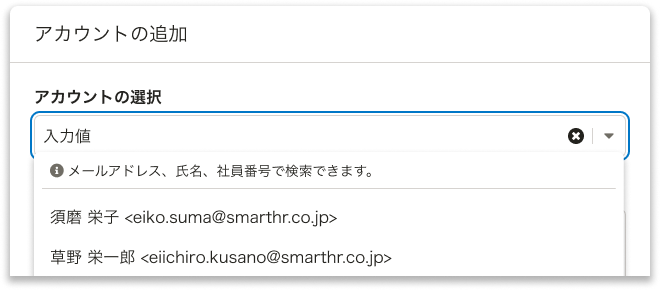

### 3. 操作の権限

アカウントに対して操作の権限（役割）を設定します。以下に代表的な役割として **「機能管理者」「業務担当者」** の2つを定義します。必要に応じて見直してください。

- 機能管理者：すべての操作の権限を持つ
- 業務担当者：業務に必要な操作の権限のみを持つ

操作の権限の指定には、[RadioButtonPanel](/products/components/radio-button-panel/)を使用してください。

**カスタム操作権限** として、操作の権限をユーザーが増やせるプロダクトもあります。この場合は、選択肢をユーザーが追加できるため、RadioButtonPanelではなく[SingleCombobox](/products/components/combobox/single-combobox/)を使ってください。

### 4. 独自の設定項目

独自の設定項目がある場合に表示します。用途によって設定が異なるため、基準やパターンは定めません。

## ロールがある場合

[ロールがない場合](#h2-0)の構成に「ロール」を加えた、「アカウント」「ロール」「操作の権限」の3つの要素を持つ構成の詳細画面です。

### アカウントの追加

アカウントの追加は、[一覧](/products/design-patterns/permissions-settings/rbac-standalone/collection/)の[（アカウントを）追加]ボタンを押したときに、[モーダルダイアログ](/products/design-patterns/modal-ui/#h3-1)で表示します。

さらに、権限を付与したいアカウントや、独自の設定項目の数などに応じて、2つのダイアログを使い分けます。

- [ActionDialogパターン](#h4-0)：1つのダイアログにすべての入力欄を並べる
- [StepFormDialogパターン](#h4-1)：要素ごとにステップを分ける

#### ActionDialogパターン

[ActionDialog](/products/components/dialog/action-dialog/)コンポーネントを使用し、ダイアログコンテンツに入力欄を設けるパターンです。

ActionDialogパターンは主に次のようなアカウント選択のUIがシンプルで良い場合に使います。

- 限られたユーザーしか機能を使わないなど、権限を付与したいアカウントが少数かつ自明なとき
- 初期リリースの開発で実装工数を圧縮したいとき

また、独自の設定項目がある場合、含められる独自の設定項目の入力欄は**1つまで**とし、2つ以上ある場合は[StepFormDialogパターン](#h4-1)を採用します。

##### 画面構成

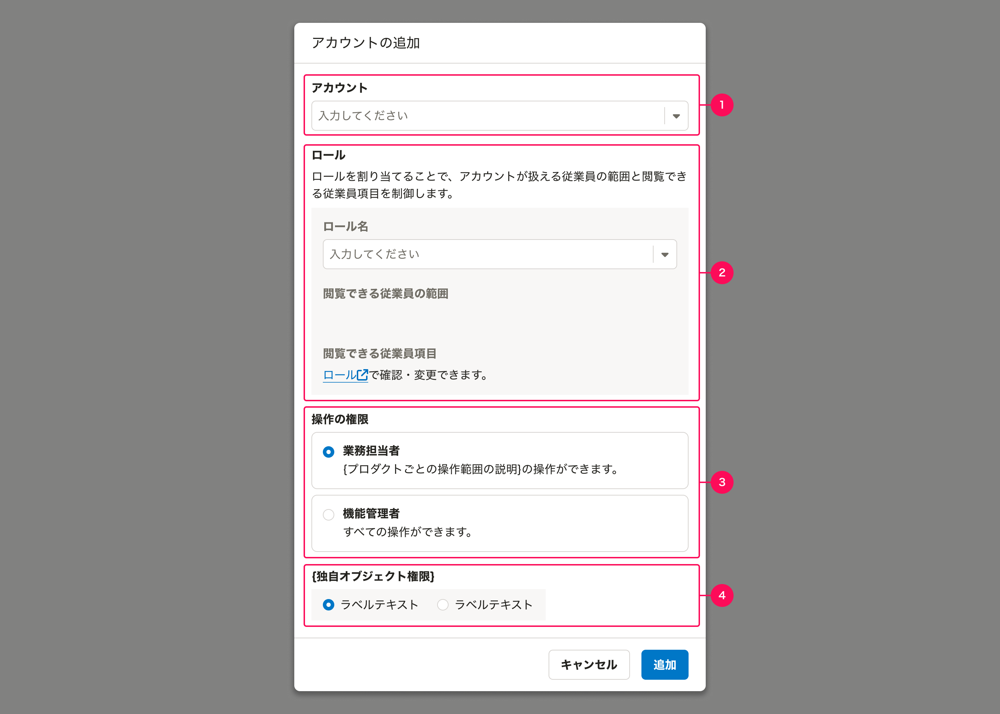

|構成要素|説明|
|:---|:---|
| 1. アカウント | 複数のアカウントを一括で追加できるよう、[MultiCombobox](/products/components/combobox/multi-combobox/)を使います。アカウントの検索対象は、プロダクトの仕様に応じて、Comboboxのパネル内に`{検索対象名1}、{検索対象名2}で検索できます。`のように明記してください。 |
| 2. ロール | [SingleCombobox](/products/components/combobox/single-combobox/)を使い、ロール名を選択します。ロール名を選ぶと、そのロールで閲覧できる従業員の範囲が展開されます。表示される情報量はロールの設定内容によって変わります。 |
| 3. 操作の権限 | [RadioButtonPanel](/products/components/radio-button-panel/)を使い、操作の権限を選択します。代表的なプリセット操作権限は「機能管理者」（すべての操作ができる）と「業務担当者」（業務に必要な操作だけができる）です。プロダクトの仕様に応じて、必要な操作の権限を定義してください。カスタム操作権限がある場合は、SingleComboboxを使ってください。 |
| 4. 独自の設定項目 | 設定項目の性質や項目数に応じて、[Combobox](/products/components/combobox/)、[RadioButton](/products/components/radio-button/)、RadioButtonPanelなどのコンポーネントを使い分けてください。 |

##### カスタム操作権限・独自の設定項目がない場合

「アカウント」「ロール」「操作の権限」の3つの要素の入力欄をダイアログの中に縦に並べます。

<Grid size="calc((100% - 24px * 1) / 2)">
  <ImgWithDesc description="アカウント追加ダイアログの初期表示。ロールが未選択のとき、閲覧できる従業員の範囲は空にする">
  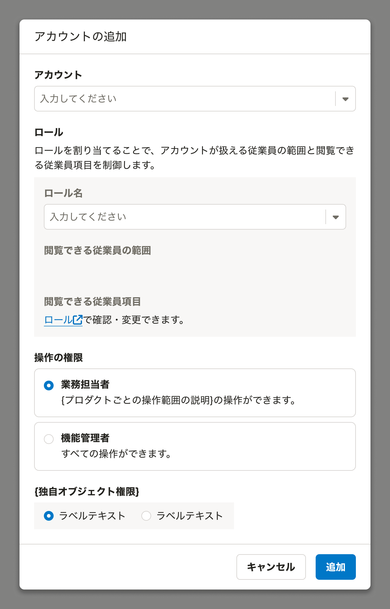
  </ImgWithDesc>
  <ImgWithDesc description="ロールが選択されたら、設定内容に応じた閲覧範囲を表示する">
  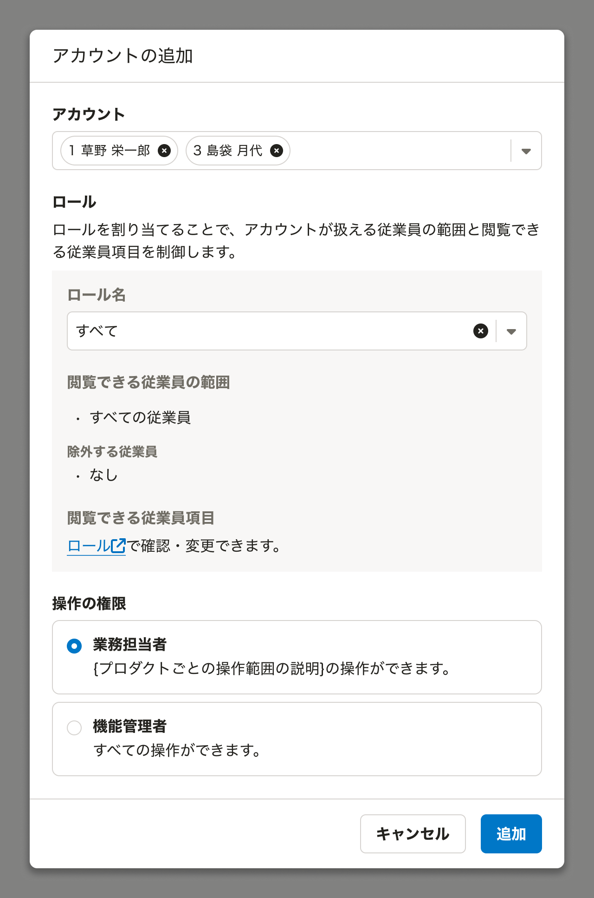
  </ImgWithDesc>
</Grid>

##### カスタム操作権限・独自の設定項目がある場合

**カスタム操作権限がある場合**  
カスタム操作権限・独自の設定項目がない場合と同じく、3つの要素の入力欄を縦に並べます。操作の権限の選択肢には、プリセット操作権限とカスタム操作権限をまとめて表示します。選択肢をユーザーが追加できるため、RadioButtonPanelではなくSingleComboboxを使います。

**独自の設定項目がある場合**  
「アカウント」「ロール」「操作の権限」「独自の設定項目」の4つの要素の入力欄をダイアログの中に縦に並べます。設定項目の性質や項目数に応じて、Combobox、RadioButton、RadioButtonPanelなどのコンポーネントを使い分けてください。

ただし、独自の設定項目の入力欄は**1つまで**とし、2つ以上ある場合は[StepFormDialogパターン](#h4-1)を採用します。

<Grid size="calc((100% - 24px * 1) / 2)">
  <ImgWithDesc description="カスタム操作権限がある場合は、操作の権限をSingleComboboxで表示する">
  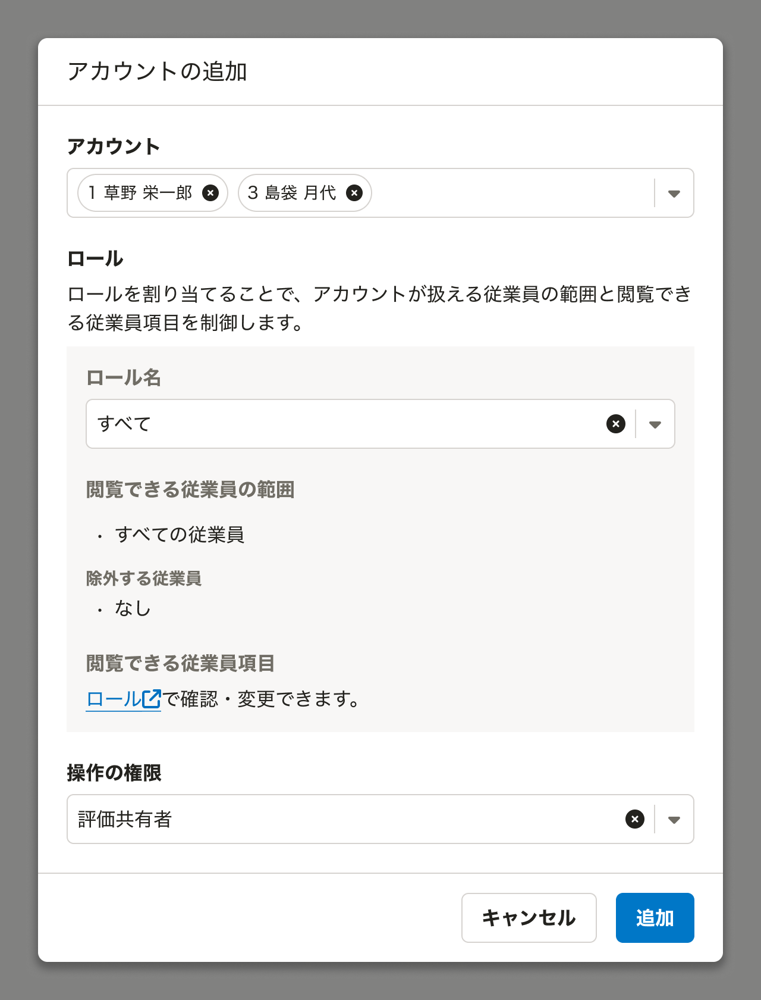
  </ImgWithDesc>
  <ImgWithDesc description="独自の設定項目がある場合は、操作の権限の下に独自の設定項目の入力欄を表示する">
  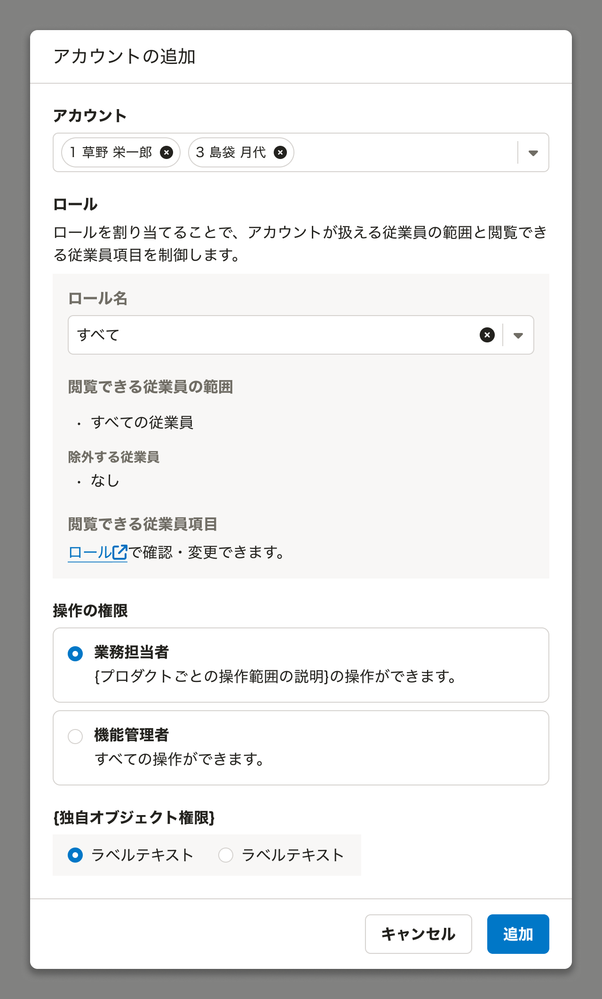
  </ImgWithDesc>
</Grid>

#### StepFormDialogパターン

[StepFormDialog](/products/components/dialog/step-form-dialog/)コンポーネントを使用し、2ステップ以上に分けて各要素の入力欄を設けるパターンです。**アカウント選択時に部署や役職などの情報も確認しながら操作したい場合**に使います。

StepFormDialogパターンは主に次のような場合に採用します。

- 多くのアカウントに権限を付与するとき
- 独自の設定項目が2つ以上あるとき

特にアカウント選択は、権限付与のミスを防ぐため所属部署や役職などの従業員情報も確認できるように[Table](/products/components/table/)コンポーネントを使って表示します。

##### 画面構成

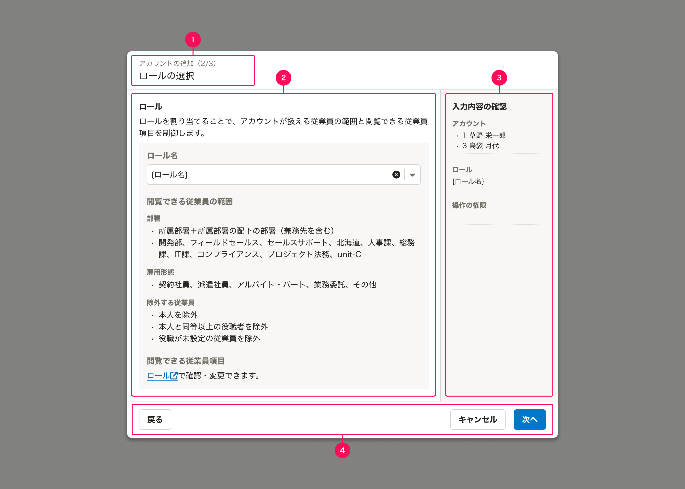

|要素|説明|
|:---|:---|
| 1. タイトル | ステップのタイトルを表示します。「アカウントの追加」とステップ数は、サブヘディングで表示します。 |
| 2. 入力エリア | ステップごとの項目を表示します。 |
| 3. 確認エリア | 各ステップで入力した内容を確認できるエリアです。表示は即座に反映させます。各項目は[DefinitionList](/products/components/definition-list/)で表示します。[確認エリアのアカウントの表示](#h6-0)も参照してください。 |
| 4. フッター | 2ステップ目以降は[戻る]ボタンを表示し、最後のステップの[Primaryボタン](/products/components/button/#h3-1)のラベルは「追加」とします。 |

###### 確認エリアのアカウントの表示

アカウントの表示は膨大になる可能性があるため、6件以上のアカウントを選択している場合はトグルボタンで表示を切り替えられるようにします。デフォルトは省略表示としますが、選択したアカウントが5件以内の場合はトグルボタンは表示しません。

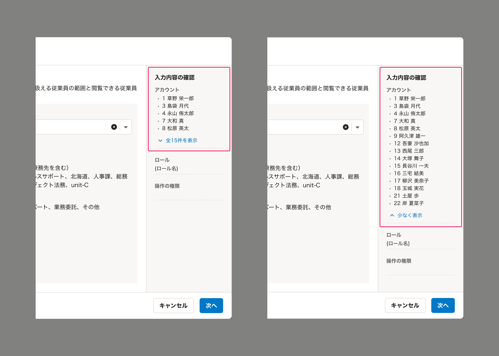

**省略表示**  
先頭の5件を表示し、`FaAngleDownIcon`を`アイコン付き（左）`（プレフィックス）に設定した[Tertiaryボタン](/products/components/button/#h3-1)で`全{n}件を表示`と表示します。`n`は選択したアカウントの合計件数です。

**全件表示**  
すべてのアカウントを表示し、`FaAngleUpIcon`を`アイコン付き（左）`（プレフィックス）に設定したTertiaryボタンで`少なく表示`と表示します。

##### 独自の設定項目がない場合

3つの要素をそれぞれステップに表示します。

- ステップ1：アカウントの選択
- ステップ2：ロールの選択
- ステップ3：操作の権限の選択

<ImgWithDesc description="ステップ1：アカウント選択。所属部署や役職なども確認しながら選択できるようにする">
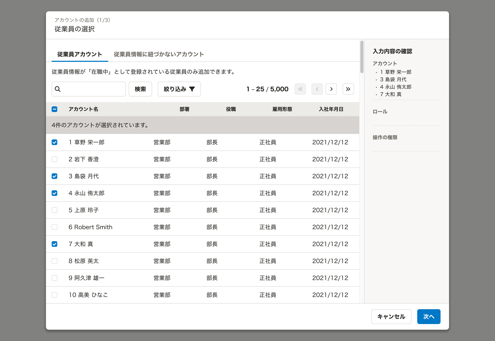
</ImgWithDesc>

<ImgWithDesc description="ステップ2：ロールの選択">
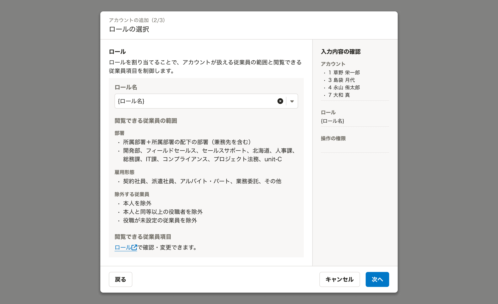
</ImgWithDesc>

<ImgWithDesc description="ステップ3：操作の権限選択">
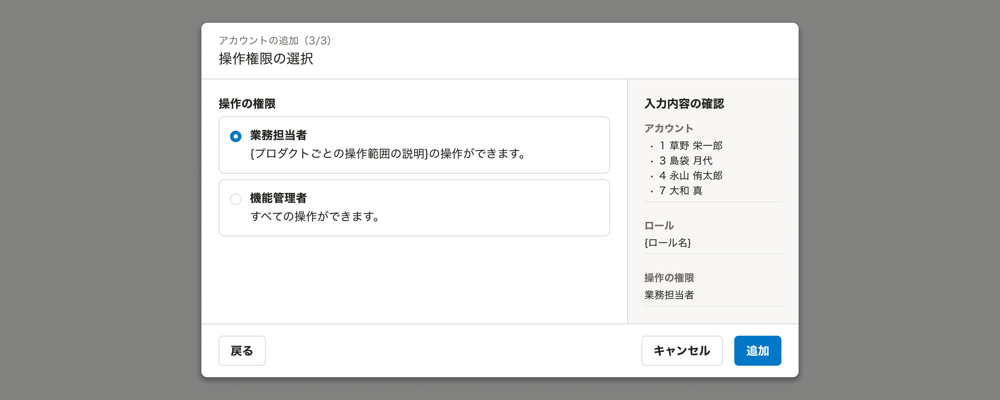
</ImgWithDesc>

<ImgWithDesc description="ステップ3：カスタム操作権限がある場合はSingleComboboxが望ましい">
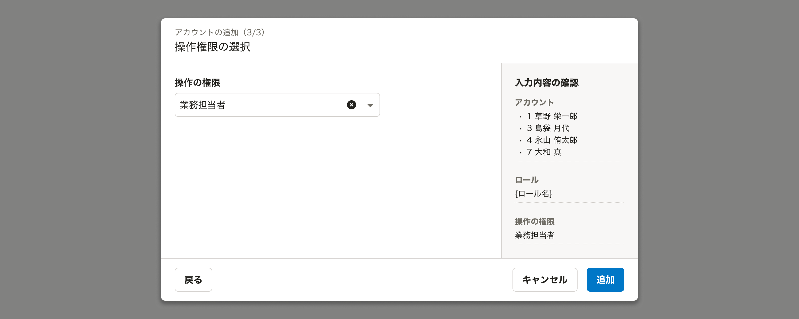
</ImgWithDesc>

##### 独自の設定項目がある場合

3ステップ目の操作の権限の下に独自の設定項目の入力欄を設けます。コンテキストや数を考慮して4ステップ目に分けることも検討してください。

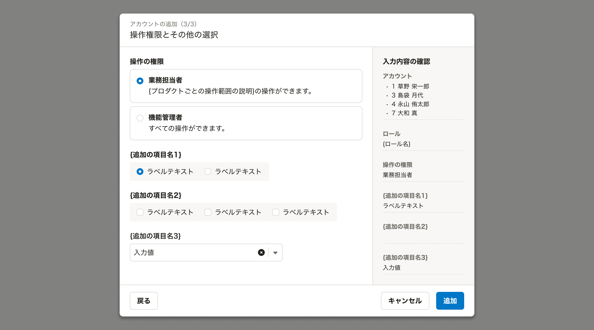

##### 独自の設定項目がある場合の派生形

独自の設定項目を必ずステップ3にまとめる必要はありません。設定項目の性質に応じて、適切なステップに配置してください。

例えば、キャリア台帳では「従業員情報の表示設定」がロールに強く関連しているため、ステップ2でロールと一緒に入力できるようにします。

<ImgWithDesc description="ステップ1：アカウント選択">
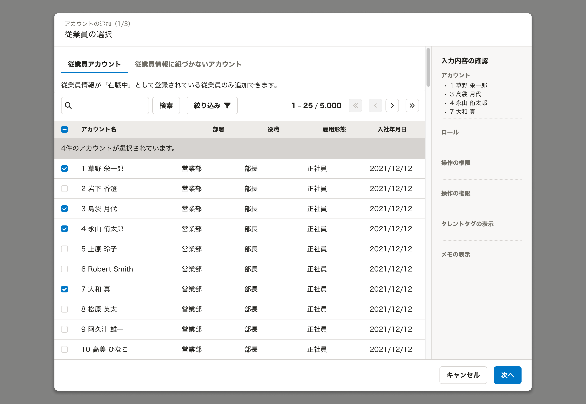
</ImgWithDesc>

<ImgWithDesc description="ステップ2：ロールに強く関連する「従業員情報の表示設定」を同じステップ2にまとめ、確認エリアの意匠も調整されている">
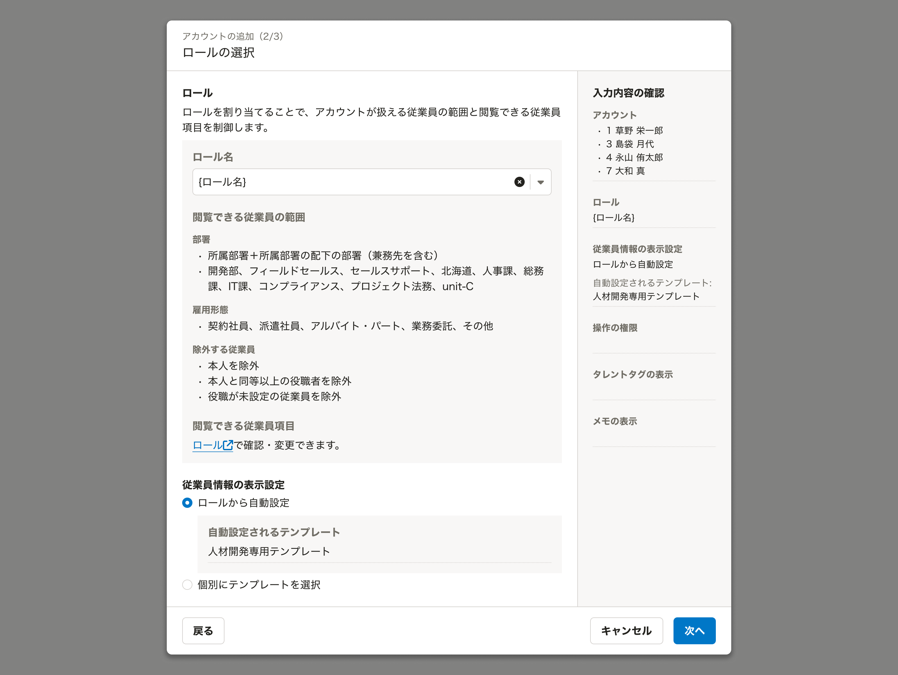
</ImgWithDesc>

<ImgWithDesc description="ステップ3：項目数が多いため、ヘルプメッセージで補足している">
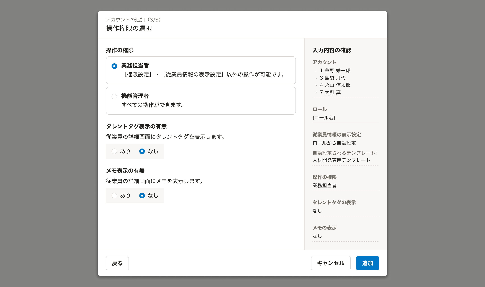
</ImgWithDesc>

### アカウントの編集

[一覧](/products/design-patterns/permissions-settings/rbac-standalone/collection/)の[（アカウントを）編集]ボタンから呼び出すダイアログです。ここでは対象のアカウントは一意に定まっているので、ActionDialogコンポーネントを採用して1画面にまとめます。

ダイアログタイトルは`アカウントの編集` 、Primaryボタンのラベルは`更新` とします。

#### 画面構成

<Grid size="calc((100% - 24px * 1) / 2)">
  <ImgWithDesc description="独自の設定項目がない場合">
  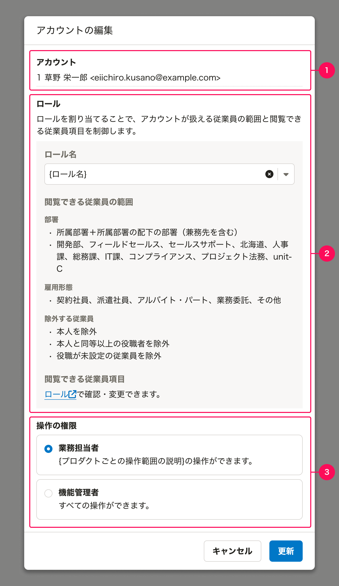
  </ImgWithDesc>
  <ImgWithDesc description="独自の設定項目がある場合。操作の権限の下に独自の設定項目を列挙する">
  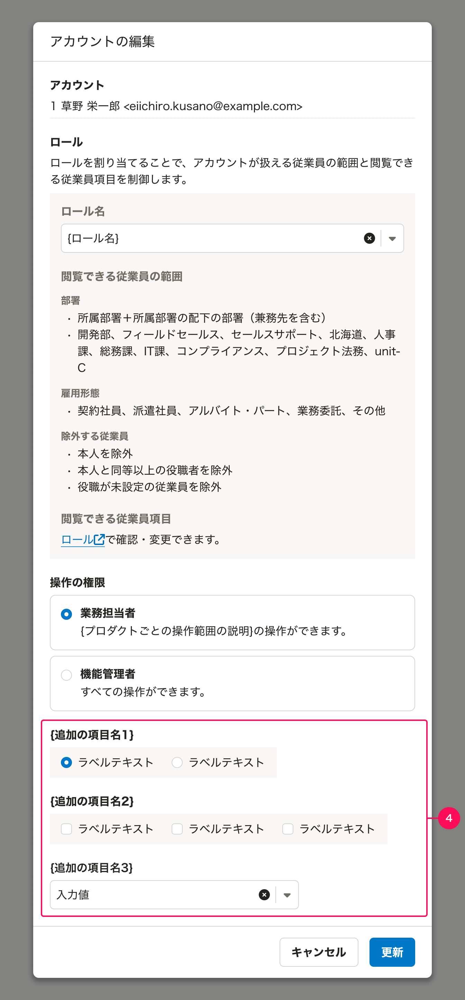
  </ImgWithDesc>
</Grid>

|要素|説明|
|:---|:---|
| 1. アカウント | 一意に定まり、かつ変更できないため、[DefinitionList](/products/components/definition-list/)を使ってアカウントを表示します。 |
| 2. ロール | SingleComboboxを使い、ロール名を選択します。ロール名を選ぶと、そのロールで閲覧できる従業員の範囲がロール名の下に展開されます。表示される情報量はロールの設定内容によって変わります。 |
| 3. 操作の権限 | RadioButtonPanelを使い、操作の権限を選択します。プロダクトの仕様に応じて、必要な操作の権限を定義してください。カスタム操作権限がある場合は、[カスタム操作権限・独自の設定項目がある場合](#h5-2)にならってSingleComboboxを使ってください。 |
| 4. 独自の設定項目 | 設定項目の性質や項目数に応じて、Combobox、RadioButton、RadioButtonPanelなどのコンポーネントを使い分けてください。 |

## アカウントの削除

[一覧](/products/design-patterns/permissions-settings/rbac-standalone/collection/)の[（アカウントを）削除]ボタンから呼び出すダイアログです。アカウントの編集と同様に対象のアカウントは一意に定まっているので、ActionDialogコンポーネントを採用します。ロールの有無にかかわらず共通です。

基本的な考え方は[削除ダイアログ](/products/design-patterns/delete-dialog/)を参照してください。

ダイアログタイトルは`アカウントの削除`とします。Submitには[Dangerボタン](/products/components/button/#h3-2)を使用してラベルは`削除`とします。

### 画面構成

削除ダイアログのライティングに従い、削除の対象となるオブジェクトをDefinitionListで提示します。

## 関連リンク

- [RBACの独自権限パターン](/products/design-patterns/permissions-settings/rbac-standalone/)
- RBAC独自権限の[一覧画面](/products/design-patterns/permissions-settings/rbac-standalone/collection/)
