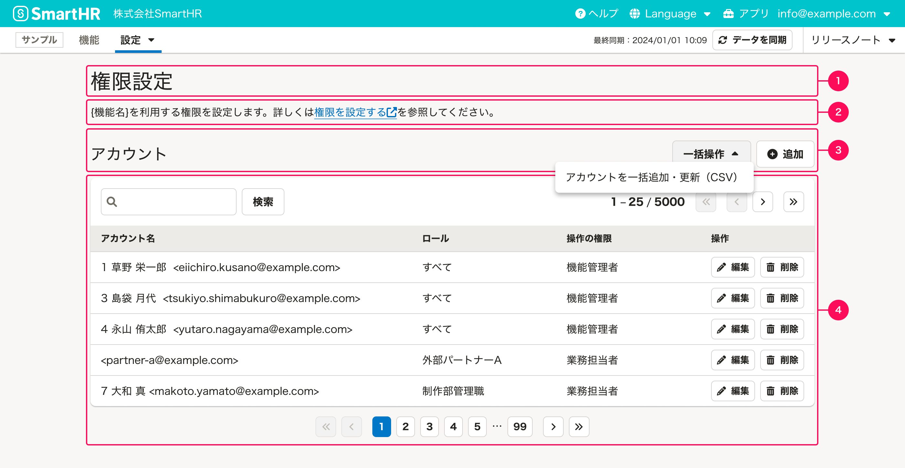
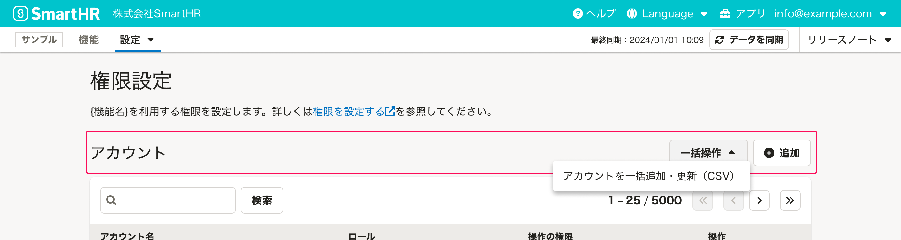
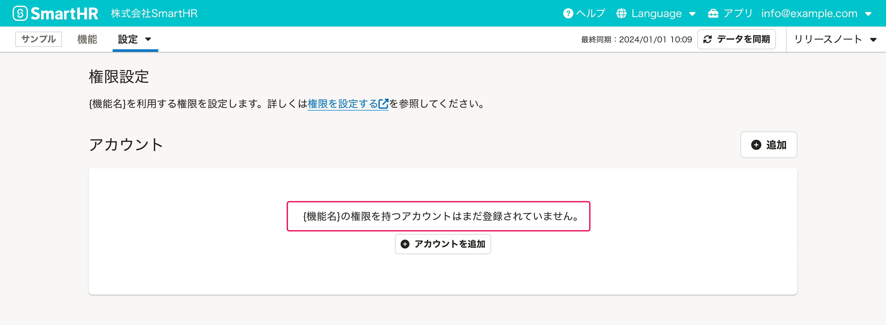
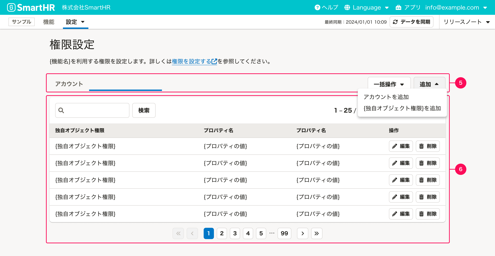
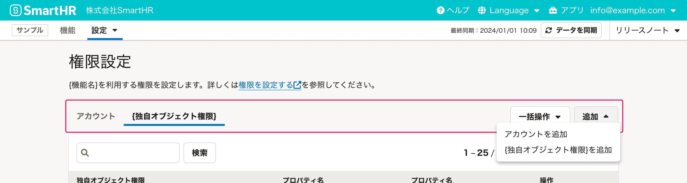
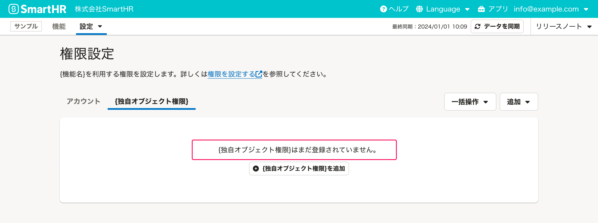

RBACの独自権限パターンのうち、ロールがある構成の一覧画面の設計をまとめています。[ロールなしの一覧画面](/products/design-patterns/permissions-settings/rbac-standalone/without-role-collection/)の構成に「ロール」を加えた、「アカウント」「ロール」「操作の権限」の3つの要素を持つ構成です。カスタム操作権限や独自の設定項目の有無によって画面の構成が異なります。

アカウントの追加や編集のダイアログについては、[ロールありの詳細画面](/products/design-patterns/permissions-settings/rbac-standalone/with-role-single/)を参照してください。

## 画面構成

カスタム操作権限と独自の設定項目がない構成の画面です。

一覧画面では、アカウントのコレクションをテーブルで表示します。テーブルにはインスタンスの「アカウント名」「ロール」「操作の権限」を表示し、操作列を設けます。

画面の構成要素は次のとおりです。

- [1. 画面タイトル](#h3-0)
- [2. リード文](#h3-1)
- [3. テーブルタイトルとアクション](#h3-2)
- [4. テーブル](#h3-3)

### 1. 画面タイトル

[ロールなしの一覧画面の画面タイトル](/products/design-patterns/permissions-settings/rbac-standalone/without-role-collection/#h3-0)と同様です。

### 2. リード文

[ロールなしの一覧画面のリード文](/products/design-patterns/permissions-settings/rbac-standalone/without-role-collection/#h3-1)と同様です。

### 3. テーブルタイトルとアクション

テーブルのタイトルは`アカウント`とします。アクションにはオブジェクトの追加ボタンを配置し、ラベルは`追加`としてください。

アカウントを「[管理アカウント](/products/design-patterns/permissions-settings/rbac-standalone/#h3-0)」と呼び替えるプロダクトでは、テーブルのタイトルを`管理アカウント`とします。

CSVを用いた一括操作がある場合は追加の[DropdownMenuButton](/products/components/dropdown/dropdown-menu-button/)を配置しても構いません。

### 4. テーブル

基本的なレイアウトは[よくあるテーブル](/products/design-patterns/smarthr-table/)に従います。テーブルには以下の情報を必ず表示し、必要に応じて列を追加してください。

|列の項目|表示する内容|
|:---|:---|
| アカウント名 | 権限を付与するアカウントです。形式は[アカウントの表記方法ガイドライン](/products/contents/ui-text/crew-account/#account-display-format)を参照してください。 |
| ロール | ロール名を表示します。 |
| 操作の権限 | 操作の権限名を表示します。 |
| 操作 | アカウントの権限を操作するボタンを置きます。必要に応じて、[編集]と[削除]以外のボタンを置いても問題ありません。コンポーネントは[Secondaryボタン](/products/components/button/#h3-2)のサイズ小を使います。 |

#### 初期表示

[よくあるテーブルの初期表示](/products/design-patterns/smarthr-table/#h3-7)のパターンに従いますが、メッセージ部分は、`{機能名}の権限を持つアカウントはまだ登録されていません。`とします。

## 選択肢をタブで管理する場合

**カスタム操作権限がある場合**  
ユーザーが操作の権限を追加・編集できる場合です。

**独自の設定項目がある場合**  
テンプレートなど、アカウントに関連づける選択肢をプロダクトのなかで管理する場合です。

これらの場合は、アカウントの一覧に加えて、操作の権限または独自の設定項目の選択肢の一覧をタブで表示します。考え方は[選択肢の管理場所と画面の関係](/products/design-patterns/permissions-settings/rbac-standalone/without-role-collection/#h2-1)を参照してください。

画面の構成要素は次のとおりです。

- 1. 画面タイトル
- 2. リード文
- [5. タブとアクション](#h3-4)
- [6. テーブル](#h3-5)

「1. 画面タイトル」と「2. リード文」は[画面構成](#h2-0)と同様です。

### 5. タブとアクション

[TabBar](/products/components/tab-bar/)コンポーネントを使用して「アカウント」と「操作の権限」または「独自の設定項目」の一覧を分けます。

TabBarのタイトルは左から`アカウント`、`操作の権限`または`{独自の設定項目名}`とします。

それぞれのオブジェクトを追加するにはDropdownMenuButtonを使い、ラベルは`追加`とします。ドロップダウンパネル内のボタンラベルはそれぞれ、`アカウントを追加`、`操作の権限を追加`、`{独自の設定項目名}を追加`とします。

アカウントを「管理アカウント」と呼び替えるプロダクトでは、タブのタイトルを`管理アカウント`、ボタンラベルを`管理アカウントを追加`とします。

CSVを用いた一括操作がある場合は追加のDropdownMenuButtonを配置しても構いません。

独自の設定項目の一覧（例：従業員情報の表示設定のテンプレート一覧）は、アカウントの追加・編集で選ぶ対象になる場合にタブとして配置できます。ただし、項目の作成や編集が複雑な場合は、権限設定画面とは別の画面で管理しても構いません。

アカウントごとに表示する・しないを決めるだけの項目など、選択肢の一覧を持たない独自の設定項目にはタブを設けません。また、アカウントと関係なく決まる設定は独自の設定項目に含まないため、タブには配置しません。詳しくは[独自の設定項目](/products/design-patterns/permissions-settings/rbac-standalone/#h3-3)を参照してください。

### 6. テーブル

「アカウント」タブの表示要件は[画面構成のテーブル](#h3-3)と同様です。

「操作の権限」または「独自の設定項目」タブの内容も、アカウントと同様によくあるテーブルで表示しますが、プロダクトの仕様に応じた項目を表示してください。

#### 初期表示

**カスタム操作権限がある場合**  
操作の権限はユーザーが自由に追加できますが、プリセット操作権限（「業務担当者」と「機能管理者」など）があるため、初期表示はプリセット操作権限を表示します。

**独自の設定項目がある場合**  
アカウントと同様、よくあるテーブルの初期表示のパターンに従いますが、メッセージ部分は、`{独自の設定項目名}はまだ登録されていません。`とします。

## 関連リンク

- [RBACの独自権限パターン](/products/design-patterns/permissions-settings/rbac-standalone/)
- [ロールありの詳細画面](/products/design-patterns/permissions-settings/rbac-standalone/with-role-single/)
- [ロールなしの一覧画面](/products/design-patterns/permissions-settings/rbac-standalone/without-role-collection/)
