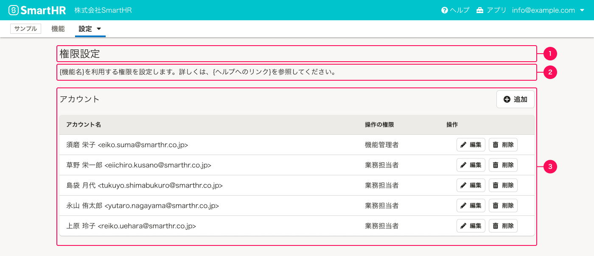
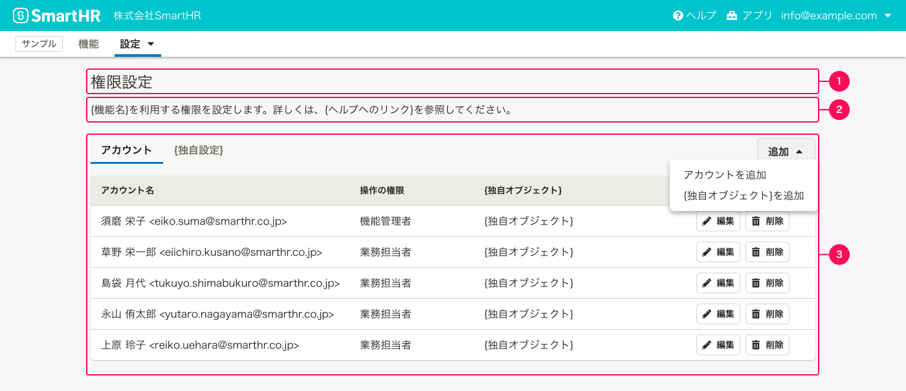
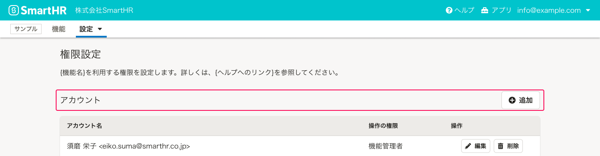
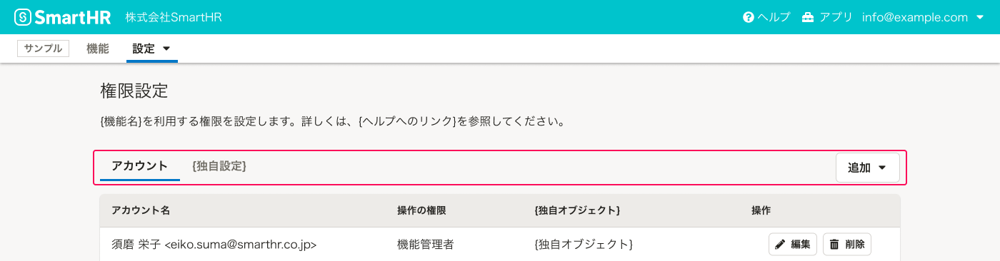
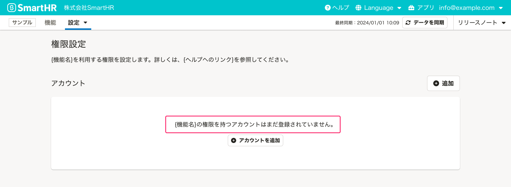

RBACの独自権限パターンのうち、ロールがない構成の一覧画面の設計をまとめています。カスタム操作権限や独自の設定項目の有無によって画面の構成が異なります。

アカウントの追加や編集のダイアログについては、[ロールなしの詳細画面](/products/design-patterns/permissions-settings/rbac-standalone/without-role-single/)を参照してください。

## 画面構成

「アカウント」「操作の権限」の2つの要素を持つ構成の一覧画面です。一覧ではアカウントを、[よくあるテーブル](/products/design-patterns/smarthr-table/)のパターンで表示します。

**一覧（アカウントのみ）**

**一覧（アカウントと独自の設定項目を扱う場合）**

### 1. 画面タイトル

画面タイトルは「権限設定」とします。

### 2. リード文

[リード文](/products/design-patterns/page-layout/#h3-0)には、機能の説明や操作に関する補足テキスト、ヘルプセンターへのリンクなどを書きます。特別な補足がない場合は、以下のメッセージを使ってください。

`{機能名}を利用する権限を設定します。詳しくは、{ヘルプへのリンク}を参照してください。`

### 3. テーブル

表には以下の情報を必ず表示します。必要に応じて、列を追加しても問題ありません。

- **アカウント名**
  - [アカウントの表記方法ガイドライン](/products/contents/ui-text/crew-account/#account-display-format)を参照してください。
- **操作の権限**
  - 操作の権限名を表示します。
- **操作**
  - アカウントを操作するボタンを置きます。必要に応じて、[編集]と[削除]以外のボタンを置いても問題ありません。
  - コンポーネントは[Secondaryボタン](/products/components/button/#h3-2)のサイズ小を使います。

#### アカウントのみの場合

アカウントのみを扱う場合のセクションタイトルは`アカウント`、オブジェクトの追加ボタンラベルは`追加`としてください。

#### 独自の設定項目がある場合

アカウントに関連づける独自の設定項目がある場合は、[TabBar](/products/components/tab-bar/)を使って並列に表示します。タブを設けるかどうかの考え方は[選択肢の管理場所と画面の関係](#h2-1)を参照してください。

TabBarのタイトルは左から`アカウント`、`{独自の設定項目名}`とします。

それぞれのオブジェクトを追加する[DropdownMenuButton](/products/components/dropdown/dropdown-menu-button/)のラベルは`追加`とします。ドロップダウンパネル内のボタンラベルはそれぞれ、`アカウントを追加`、`{独自の設定項目名}を追加`とします。

#### 初期表示

基本は[よくあるテーブルの初期表示](/products/design-patterns/smarthr-table/#h3-7)のパターンに従いますが、メッセージ部分は、`{機能名}の権限を持つアカウントはまだ登録されていません。`とします。

## 選択肢の管理場所と画面の関係

各要素の選択肢をどこで管理するかによって、一覧画面にタブを設けるかどうかが決まります。ロールがある構成でも共通の考え方です。

- 選択肢をプロダクトのなかでユーザーが追加・編集できる要素（カスタム操作権限、テンプレートなどを選ぶ独自の設定項目）は、一覧画面にタブを設けて選択肢を管理します。
- ロールや、プリセット操作権限だけの操作の権限は、選択肢をプロダクトのなかで編集しないため、タブを設けません。

## 関連リンク

- [RBACの独自権限パターン](/products/design-patterns/permissions-settings/rbac-standalone/)
- [ロールなしの詳細画面](/products/design-patterns/permissions-settings/rbac-standalone/without-role-single/)
- [ロールありの一覧画面](/products/design-patterns/permissions-settings/rbac-standalone/with-role-collection/)
