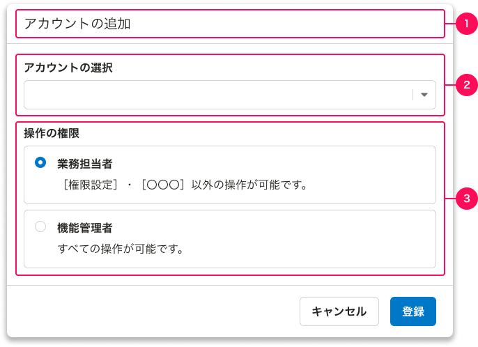
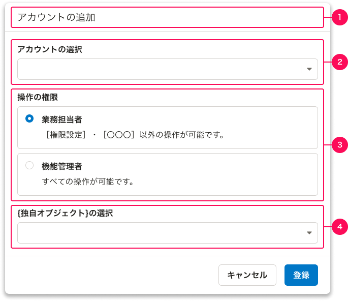
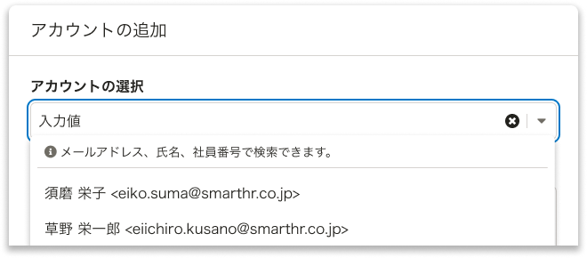

RBACの独自権限パターンのうち、ロールがない構成の詳細画面（アカウントの追加・編集・削除のダイアログ）の設計をまとめています。

アカウントや独自の設定項目の一覧については、[ロールなしの一覧画面](/products/design-patterns/permissions-settings/rbac-standalone/without-role-collection/)を参照してください。

## アカウントの追加・編集

「アカウント」「操作の権限」の2つの要素を持つ構成の詳細画面です。

一覧の[（アカウントを）追加]、または[（アカウントを）編集]ボタンを押したときに[ActionDialog](/products/components/dialog/action-dialog/)で表示します。
例はすべて追加時のスクリーンショットです。必要に応じて編集に読み替えてください。

構成要素は次のとおりです。

- [1. ダイアログタイトル](#h3-0)
- [2. アカウントの選択](#h3-1)
- [3. 操作の権限](#h3-2)
- [4. 独自の設定項目](#h3-3)

**詳細ダイアログ（アカウントのみ）**

**詳細ダイアログ（独自の設定項目がある場合）**

### 1. ダイアログタイトル

追加の場合は、「アカウントの追加」とします。編集の場合は、「アカウントの編集」とします。

### 2. アカウントの選択

SmartHRのアカウントを選択します。複数のアカウントを一括で追加できるよう、[MultiCombobox](/products/components/combobox/multi-combobox/)を使います。

Comboboxのパネル内の説明には`{検索対象名1}、{検索対象名2}で検索できます。`と、検索できる項目を明記します。

### 3. 操作の権限

アカウントに対して操作の権限（役割）を設定します。以下に代表的な役割として **「機能管理者」「業務担当者」** の2つを定義します。必要に応じて見直してください。

- 機能管理者：すべての操作の権限を持つ
- 業務担当者：業務に必要な操作の権限のみを持つ

操作の権限の指定には、[RadioButtonPanel](/products/components/radio-button-panel/)を使用してください。

**カスタム操作権限** として、操作の権限をユーザーが増やせるプロダクトもあります。この場合は、選択肢をユーザーが追加できるため、RadioButtonPanelではなく[SingleCombobox](/products/components/combobox/single-combobox/)を使ってください。

### 4. 独自の設定項目

独自の設定項目がある場合に表示します。用途によって設定が異なるため、基準やパターンは定めません。

## アカウントの削除

一覧の[（アカウントを）削除]ボタンから呼び出すダイアログです。アカウントの編集と同様に対象のアカウントは一意に定まっているので、ActionDialogコンポーネントを採用します。ロールがある構成でも共通です。

基本的な考え方は[削除ダイアログ](/products/design-patterns/delete-dialog/)を参照してください。

ダイアログタイトルは`アカウントの削除`とします。Submitには[Dangerボタン](/products/components/button/#h3-2)を使用してラベルは`削除`とします。

### 画面構成

削除ダイアログのライティングに従い、削除の対象となるオブジェクトをDefinitionListで提示します。

## 関連リンク

- [RBACの独自権限パターン](/products/design-patterns/permissions-settings/rbac-standalone/)
- [ロールなしの一覧画面](/products/design-patterns/permissions-settings/rbac-standalone/without-role-collection/)
- [ロールありの詳細画面](/products/design-patterns/permissions-settings/rbac-standalone/with-role-single/)
